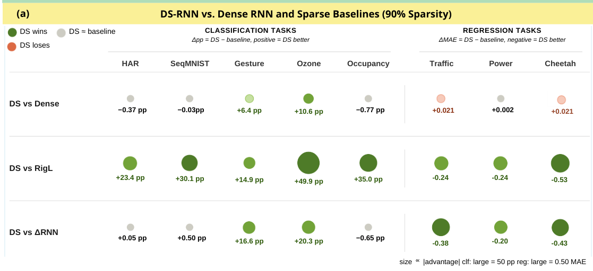
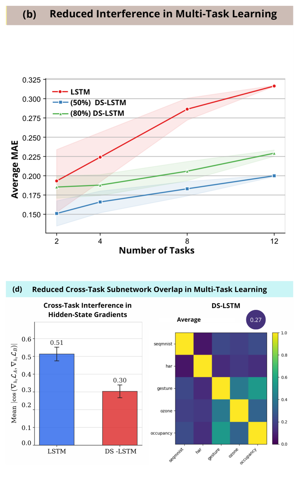
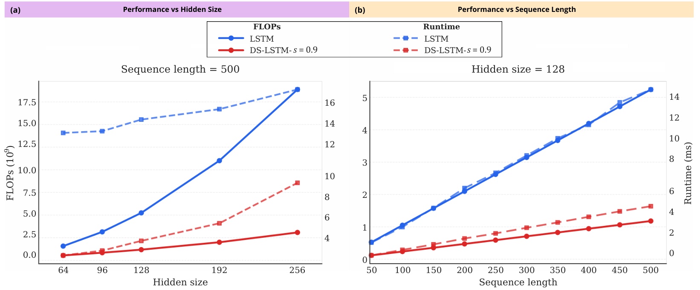

# DS-RNN: Dynamic Sparse Recurrent Neural Networks

**Official PyTorch implementation** of
[*DS-RNNs: Conditional Computation in Recurrent Models via Input-Dependent Sparse Gating*](https://openreview.net/forum?id=8LkOGzFcVL), accepted in **Transactions on Machine Learning Research (TMLR), 2026**.

DS-RNNs introduce **input-dependent structured sparsity** into recurrent neural networks and state-space models. A lightweight router dynamically selects a subset of active input and hidden channels for each recurrent update, enabling conditional computation without specialized sparse kernels. 

By operating on compact dense submatrices, DS-RNNs reduce computational cost while maintaining competitive predictive performance at high sparsity. The framework supports **LSTM, GRU, LTC, S4, and Liquid-S4** architectures.

<p align="center">
  
</p>

<p align="center">
  <em>
    Figure 1. DS-RNN method overview. A lightweight router selects active input and hidden-state channels. Different inputs and tasks can activate distinct subnetworks while sharing the same weight matrices.
  </em>
</p>

<details>
<summary><strong>Paper Abstract</strong></summary>

<em>Recurrent neural networks (RNNs) and state-space models (SSMs) typically execute the same dense computation for every input, coupling inference cost to parameter count and exacerbating interference in multi-task or heterogeneous regimes. We introduce Dynamic-Sparse RNNs (DS-RNNs), a framework for conditional computation via learnable, input-dependent sparse gating. In DS-RNNs, a small router network predicts sparse masks over input and hidden-state channels, effectively routing each input to a specialized sparse subnetwork, whose size is fixed by the target sparsity. Unlike prior adaptive methods such as DeltaRNNs or static sparse training like RigL, our approach is fully learned and budget-controlled, and utilizes structured masking that translates into practical FLOP savings on commodity hardware by reducing sparse matrix multiplications to dense operations on active submatrices. Empirically, DS-RNNs maintain most of the dense model performance at 90% sparsity (sometimes even exceeding it) across diverse architectures, including LSTMs, GRUs, LTCs, and S4 models. They match or outperform RigL and DeltaRNNs on most tasks, while remaining stable in regimes where these baselines fail. We further show that DS-RNNs naturally induce subnetwork specialization without explicit supervision: masks for different classes exhibit low overlap and are predictive of class identity. Our theoretical analysis provides intuition for this behavior, linking it to a formal bound on gradient interference. As a result, DS-RNNs improve robustness: DS-LSTM scales better with task count in multi-task regression and consistently reduces forgetting across benchmarks when combined with standard continual learning methods (e.g., GEM, replay).</em>
</details>


## Key Results
<details>
<summary><strong>Key Results</strong></summary>

- **Predictive performance:** At 90% sparsity, DS-RNNs preserve much of dense-model performance across LSTM, GRU, and LTC, and generally match or outperform RigL and DeltaRNN. Sparse S4 variants also remain competitive on several long-range tasks.
- **Multi-task robustness and specialization:** DS-LSTM degrades more gracefully as task count increases. In a separate five-task analysis, mean cross-task mask IoU is **0.27**, and hidden-state gradient similarity is **0.30** versus **0.51** for dense LSTM, consistent with reduced interference.
- **Continual learning:** Combined with standard continual learning methods, DS-RNNs improve stream accuracy and reduce forgetting on the evaluated benchmarks.
- **Proof-of-concept efficiency:** At 90% sparsity, DS-LSTM achieves **77.5% fewer FLOPs** and a **3.1× forward-pass speedup** over dense LSTM in one RTX 4090 benchmark (hidden size 128, sequence length 500, batch size 64, input size 32).

### Predictive Performance

<p align="center">
  
</p>

### Multi-Task Robustness and Subnetwork Specialization

<p align="center">
  
</p>

### Computational Efficiency

<p align="center">
  
</p>

Full experimental results, configurations, and analysis are in the [paper](https://openreview.net/forum?id=8LkOGzFcVL).

</details>


## Installation

```bash
pip install -e .                        # core library
pip install -e ".[experiments,data]"    # benchmark training stack + datasets
pip install -e ".[cl]"                  # continual learning (Avalanche)
pip install -e ".[analysis,ww]"         # mask-analysis + WeightWatcher callbacks
pip install -e ".[wandb]"               # optional Weights & Biases logging
```

## Quickstart

```python
import torch
from dsrnn.models.dslstm_model import DSLSTM
from dsrnn.nn.router import RouterConfig

model = DSLSTM(
    input_size=28,
    hidden_size=128,
    router_config=RouterConfig(
        num_channels=128,   # hidden channels being routed
        input_dim=28,       # per-timestep input dimension
        context_dim=4,      # router context width (R in the paper)
        sparsity=0.9,       # fraction of channels deactivated
        backward="selected_only",  # or "ste"
    ),
    implementation="gathered",      # restrict matmuls to the active channels
    output_size=10,
)

x = torch.randn(64, 28, 28)         # (batch, time, features)
out, (h, c) = model(x)              # out: (batch, time, 10)
```

The cell-level API (`dsrnn.nn.cells`) exposes the same routing through a standard `forward(x, state)` interface, so DS-RNN cells drop into existing recurrent loops. The sequence models (`dsrnn.models`) additionally precompute routing over the full sequence and gather the active input channels once, amortizing the router overhead. `implementation="dense"` applies the same masks without gathering (useful as a reference and required for the STE backward rule in DS-LTC), `implementation="gathered"` restricts matrix multiplications to the active channels, enabling computational savings.

## Repository layout

```
dsrnn/
  nn/           cells, router, gathered/dense masked matmuls, SSM kernels
  models/       DSLSTM, DSGRU, DSLTC, dense LTC, generic multi-layer DSRNN
  data/         benchmark datamodules (classification, forecasting, LRA,
                multitask, synthetic, HalfCheetah)
  training/     LightningModules, pruning (RigL), ablations, optimizers,
                analysis callbacks
  utils/        logging, graph metrics, mask-similarity, visualization
experiments/    one entry point per benchmark (see below)
tests/          equivalence, gradient, and smoke tests
```

## Reproducing the paper
The `experiments/` directory contains scripts for reproducing the benchmarks, baselines, and analyses presented in the paper (and some more). All experiment entry points use `argparse` and support:

- `--config`: Optional YAML configuration file providing default arguments. Explicit command-line arguments override it.
- `--seed`: Random seed for reproducibility.
- `--use_wandb`: Optional Weights & Biases logging (CSV/none by default).

| Experiment | Script | Example |
|---|---|---|
| DS vs. dense RNNs | `experiments/train_classification.py` | `--task seqmnist --model_type dslstm --sparsity 0.9` |
| Forecasting (ETT) | `experiments/train_forecasting.py` | `--dataset etth1 --model_type dslstm` |
| DS-S4 on LRA | `experiments/train_lra.py` | `--task cifar --model_type dss4 --sparsity 0.9` |
| DS vs. RigL | `experiments/train_pruning.py` | `--task seqmnist --model_type gru --sparsity 0.9` |
| DS vs. DeltaRNN | `experiments/train_deltarnn.py` | `--task seqmnist --model_type gru --thx 0.1 --thh 0.1` |
| Ablations (SNIP / learned / random) | `experiments/train_ablation_masking.py` | `--task seqmnist --masker random` |
| Multi-task | `experiments/train_multitask.py` | `--tasks seqmnist har gesture ozone occupancy` |
| Continual learning | `experiments/continual_learning.py` | `--benchmark splitmnist --strategy gem` |
| Efficiency (FLOPs / runtime) | `experiments/benchmark.py` | `--sweep both --plot fig.png` |


## Running the tests

```bash
pip install -e ".[experiments,data,analysis,ww]"
pytest tests/ -q
```

The suite covers cell/model equivalence (generic vs. gathered), gradient
correctness, the training stack, LRA, the baselines, the analysis callbacks,
and multitask. Tests that need an optional dependency skip cleanly if it is
absent.

## Citation

```bibtex
@article{dsrnn,
  title   = {DS-RNNs: Conditional Computation in Recurrent Models via
             Input-Dependent Sparse Gating},
  journal = {Transactions on Machine Learning Research},
  year    = {2026},
  note    = {Under review},
}
```

## License

MIT
